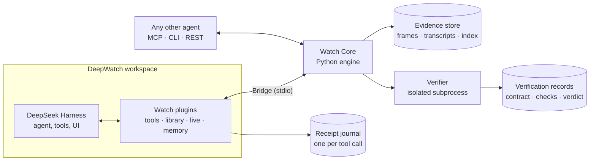

<!-- mcp-name: io.github.oxbshw/watch-skill -->
<div align="center">


# Watch Skill · DeepWatch

**Give AI agents eyes, ears, and verifiable results.**

**Watch Skill** turns video, audio and screen activity into searchable,
timestamped evidence, and answers *did that actually work?* with a
deterministic contract rather than a model's opinion. Available as a zero-dependency
standalone Windows executable/installer, Python CLI, MCP server, and REST API.

**DeepWatch** is a ready-made agent workspace, built on the official DeepSeek
Harness with Watch Skill already composed in, where a tool call leaves a receipt
you can open and a result can be checked by something other than the agent that
produced it.

<br>

**Distribution & Releases**

[&color=blue&logo=github)](https://github.com/codevcn/watch-skill/releases/tag/core-v1.5.6)
[](https://github.com/codevcn/watch-skill/releases/tag/core-v1.5.6)
[](LICENSE)

**Python · PyPI**

[](https://pypi.org/project/watch-skill/)
[](https://pypistats.org/packages/watch-skill)
[](https://pypi.org/project/watch-skill/)

**Node · npm**

[](https://www.npmjs.com/package/@deepwatch/cli)
[](https://www.npmjs.com/package/@deepwatch/dsh-bundle)
[](workspace/docs/install-and-upgrade.md)

**Quality Gates & Agents**

[](https://github.com/codevcn/watch-skill/actions/workflows/ci.yml)
[](https://github.com/codevcn/watch-skill/actions/workflows/workspace-ci.yml)
[](https://github.com/codevcn/watch-skill/actions/workflows/package-windows.yml)
[](https://www.skills.sh/oxbshw/watch-skill/watch)
[](docs/agents/README.md)

[Quick Install](#start-here) ·
[Windows 1-Click](#windows-1-click-installer--standalone-binaries) ·
[Agent Integration](#ai-agent-integration--protocol) ·
[Auto-Update Check](#smart-background-auto-update-check) ·
[DeepWatch Workspace](#the-deepwatch-workspace) ·
[THE LOOP](#the-loop-observe-act-verify) ·
[Architecture](#how-it-fits-together) ·
[CLI Reference](#cli-command-reference) ·
[Attribution](#acknowledgements--upstream-attribution)

</div>

---

## Two capabilities, and they work apart

**Perception.** Video, audio and screen activity become frames, transcripts and
OCR text, each carrying an absolute timestamp. Index a source once and query it
for as long as you keep it; every answer cites a moment you can open.

**Verification.** A frozen contract — file digests, JSON values, SQL results,
HTTP responses, DOM state — is evaluated by a separate process. The verdict is
`VERIFIED`, `FAILED`, `UNVERIFIED` or `INCONCLUSIVE`, and it does not come from
a language model.

Either is useful on its own, and the split is deliberate.

<table>
<tr>
<td width="50%" valign="top">

### Watch Skill — the engine

Index a recording once and ask it questions for as long as you keep it. Answers
cite timestamps you can open. Verification contracts check file digests, JSON
values, SQL results, HTTP responses and DOM state, and report *passed*,
*failed*, *unverified* or *inconclusive* — four answers, because three of them
are not the same as "no".

Any agent can use it: **MCP**, a **CLI**, a **Windows standalone binary**, or a **REST** API.

</td>
<td width="50%" valign="top">

###  DeepWatch — the workspace

Built on the official
[DeepSeek Harness](https://github.com/deepseek-ai/deepseek-harness), with Watch
Skill composed in, installed by one command. You get an agent that
can see and prove, without wiring anything together yourself.

Every tool call leaves a receipt naming what it touched. Every path a tool
declares is checked against one workspace boundary, so a tool cannot quietly
write outside it. Results carry a Core verdict you can open, and the Library
keeps them after a restart.

Runs in your browser. Compare puts two runs of the same contract side by side
and shows where their verdicts diverged.

</td>
</tr>
</table>

**Watch Skill sees and proves. DeepWatch is the workspace it comes built into.**

---

## Start here

Five entry paths. Pick the row that describes your environment.

| You have | You want | Recommended path |
| --- | --- | --- |
| **Windows (Zero Python/Node)** | 1-Click native installation & updates | [Windows 1-Click Installer](#windows-1-click-installer--standalone-binaries) |
| **Windows Portable** | Single `.exe` without installation | [Standalone Binary Release](#windows-1-click-installer--standalone-binaries) |
| **AI Agent (Antigravity, Claude Code, Cursor, Codex)** | Pair-programming skill & CLI envelope | [AI Agent Integration](#ai-agent-integration--protocol) |
| **Python 3.11, 3.12 or 3.13** | Core engine CLI, MCP server, REST API | [Python & CLI Quickstart](#python--cross-platform-cli) |
| **Complete Agent Workspace** | DeepSeek Harness with visual verification | [DeepWatch Workspace](#the-deepwatch-workspace) |

---

## Windows 1-Click Installer & Standalone Binaries

For zero-dependency deployment on Windows, download precompiled binaries from the **[v1.5.6 Release](https://github.com/codevcn/watch-skill/releases/tag/core-v1.5.6)**:

| Asset | Type | Size | Description & Checksum (SHA-256) |
|---|---|---|---|
| **[`watch-skill-installer.exe`](https://github.com/codevcn/watch-skill/releases/download/core-v1.5.6/watch-skill-installer.exe)** | Setup Wizard | ~24.4 MB | **Recommended.** Installs to `%LOCALAPPDATA%\Programs\watch-skill`, sets User `PATH`, registers Windows Uninstaller.<br>`a43dd9e28b4c713a479a037b581c47b3c3878ae24b6ddbb9a9a606c4ed521afe` |
| **[`watch-skill-windows-x86_64.exe`](https://github.com/codevcn/watch-skill/releases/download/core-v1.5.6/watch-skill-windows-x86_64.exe)** | Portable Binary | ~28.4 MB | Standalone portable executable. Copy anywhere and run directly.<br>`ef2b5ee8427f22c95acdfc3436fa4799eca735896804c1b4479305d9c90887f1` |
| **[`watch-skill-uninstaller.exe`](https://github.com/codevcn/watch-skill/releases/download/core-v1.5.6/watch-skill-uninstaller.exe)** | Clean Uninstaller | ~4.8 MB | Removes binary, cleans `PATH`, and deletes cache/logs.<br>`38bf067439263aa5b2226f0a84fd704211fcb63a1b58b8b7a927ff6e0c039b4f` |
| **[`SHA256SUMS.txt`](https://github.com/codevcn/watch-skill/releases/download/core-v1.5.6/SHA256SUMS.txt)** | Verification | ~300 B | Cryptographic checksums for asset integrity verification. |

### 1-Click Installation Steps

1. Download **[`watch-skill-installer.exe`](https://github.com/codevcn/watch-skill/releases/download/core-v1.5.6/watch-skill-installer.exe)**.
2. Double-click to run (no administrator rights required).
3. Open a new PowerShell terminal and verify:
   ```powershell
   watch-skill --version
   watch-skill doctor --json
   ```

### Clean Uninstallation

You can remove `watch-skill` cleanly at any time through **Windows Settings → Installed Apps** (Add or Remove Programs) or by running:
```powershell
%LOCALAPPDATA%\Programs\watch-skill\watch-skill-uninstaller.exe
```

---

## AI Agent Integration & Protocol

`watch-skill` is engineered agent-first. Any AI Agent (Google Antigravity, Claude Code, Cursor, Codex CLI, Gemini CLI) can directly command the CLI or invoke its stdio MCP server.

<div align="center">

[](docs/agents/claude-code.md)
[](docs/agents/cursor.md)
[](docs/agents/codex-cli.md)
[](docs/agents/github-copilot-cli.md)
[](docs/agents/gemini-cli.md)
[](docs/agents/cline.md)
[](docs/agents/zed.md)
[](docs/agents/windsurf.md)
[](docs/agents/opencode.md)
[](docs/agents/vscode.md)

**[Every supported client, and how far each is verified →](docs/agents/README.md)**

</div>

### Installing the Agent Skill

To give your agent native video-watching workflows, copy or link [`skills/watch-video-cli/SKILL.md`](skills/watch-video-cli/SKILL.md) to your agent's skill directory:

```powershell
# For Antigravity (Google DeepMind)
New-Item -ItemType Directory -Force "$env:USERPROFILE\.gemini\config\skills\watch-video-cli"
Copy-Item "skills\watch-video-cli\SKILL.md" "$env:USERPROFILE\.gemini\config\skills\watch-video-cli\"

# For Claude Code
New-Item -ItemType Directory -Force "$env:USERPROFILE\.claude\skills\watch-video-cli"
Copy-Item "skills\watch-video-cli\SKILL.md" "$env:USERPROFILE\.claude\skills\watch-video-cli\"
```

Or install all ten skills across 25+ agents simultaneously:
```bash
npx skills add oxbshw/watch-skill -g
```

### The Agent CLI Protocol Envelope

When invoking `watch-skill` from an agent terminal tool:

1. **Deterministic `--json` Envelope**: Always pass `--json` to `watch`, `ask`, `moment`, `search`, `list`, or `config`. Stdout contains strict, machine-readable JSON:
   ```bash
   watch-skill moment <video_id> 00:45 --window 8.0 --json
   ```
2. **Visual Multimodal Grounding via `frame_paths`**: The JSON payload returns absolute, fully-resolved filesystem paths to extracted frames. Multimodal agents can inspect these images directly with native vision tools to confirm UI states.
3. **Structured Error Recovery**: Every error payload carries a machine-readable `code` and an actionable `fix` sentence so the agent can self-correct without guessing.
4. **Zero Configuration Leakage**: Configure provider credentials securely:
   ```bash
   watch-skill config set WATCHSKILL_GROQ_API_KEY gsk_...
   watch-skill config list --json   # Secrets are masked automatically
   ```

---

## Smart Background Auto-Update Check

The standalone Windows executable and CLI feature an intelligent, non-blocking background update checker designed specifically for unattended AI workflows:

```
┌──────────────────────────────────────────────────────────────┐
│  A new version of watch-skill is available: 1.5.6 -> 1.6.0   │
│  Download installer: https://github.com/codevcn/watch-skill  │
└──────────────────────────────────────────────────────────────┘
```

- **Non-blocking Execution**: Network checks run in a dedicated background thread with a strict **0.8-second timeout**. Local CLI commands execute immediately without network latency.
- **Stderr-Only Notice**: Update notifications are written exclusively to `stderr`. `stdout` remains pristine JSON, ensuring machine-readable contracts never break for automated agents.
- **24-Hour TTL Cache**: Releases are cached locally at `%LOCALAPPDATA%\watch-skill\update_check.json`. The network is never queried more than once every 24 hours.
- **Atomic Concurrency Lock**: Multi-agent sessions or parallel CLI calls use file-lock semantics (`.lock`) to prevent redundant checks.
- **Opt-Out Control**: Disable the check anytime via environment variable or persistent configuration:
  ```bash
  # Via environment variable
  export WATCHSKILL_NO_UPDATE_CHECK=1

  # Or persistently via CLI
  watch-skill config set WATCHSKILL_CHECK_UPDATES false
  ```

---

## Python & Cross-Platform CLI

For macOS, Linux, and Python environments, `watch-skill` supports Python 3.11, 3.12 or 3.13 (Python 3.11+).

### Via `uvx` / `pipx` (Recommended)

```bash
# Ephemeral run via uvx
uvx --from "watch-skill[cli]" watch-skill --help

# Or persistent install via pipx
pipx install "watch-skill[cli]"
```

### Via `pip`

```bash
pip install 'watch-skill[standard]'   # frames, retrieval and the MCP server
watch-skill doctor                    # checks, and repairs what it can
watch-skill watch <video-url-or-file>
watch-skill ask <id> "what changed at 3:12?"
```

**Take the extra seriously.** A bare `pip install watch-skill` provides the CLI and verifier, but cannot extract frames. `[standard]` includes frames, retrieval and MCP; add `[ocr]` to read on-screen text, `[whisper]` for local transcription, `[loop]` for browser verification, or install `[all]`.

### Wire into any MCP Client

```bash
watch-skill serve              # stdio MCP server, 39 tools
```

---

## The DeepWatch Workspace

**Prerequisites.** Node `^22.19 || >=24`, and Python 3.11, 3.12 or 3.13 for the perception/verification engine.

```bash
# 1. the engine that sees and proves
pip install 'watch-skill[standard,ocr]'

# 2. the workspace
npm install -g @deepwatch/cli
deepwatch doctor                     # what is present, what is missing, how to fix it
deepwatch setup                      # builds the runtime; shows the download and asks first

# 3. a workspace directory to work in
mkdir my-project
deepwatch web --workspace ./my-project
```

`deepwatch web` prints a local URL and opens the workspace in your browser:

<div align="center">

</div>

**Without a global install**, the same package through `npx`:

```bash
npx --yes @deepwatch/cli setup
mkdir my-project
npx --yes @deepwatch/cli web --workspace ./my-project
```

#### Connect a Model and Prove the Connection

| In the app | What it does |
| --- | --- |
| **Settings → Models → Add provider** | Names a provider and takes a key, *or* reads one from the launch environment. |
| **Settings → Role Bindings → Choose a model** | Binds a specific provider and model to a role — Chat, or Visual perception. |
| **Run provider test** | Sends one real request to that exact binding and reports what came back. |
| **Ready** | Only now will the workspace send anything to it. |

<div align="center">

</div>

### DeepSeek Harness Integration

Add Watch capabilities to a DeepSeek Harness profile you already run:

```bash
cd <your-project>
dsh plugin --profile <your-profile> add @deepwatch/dsh-bundle
dsh --profile <your-profile>
```

Full guide: **[`@deepwatch/dsh-bundle`](workspace/packages/watch/bundle/README.md)**.

---

## THE LOOP: observe, act, verify

Perception is only half of it. THE LOOP is what an agent does with perception when fixing software.

<div align="center">

</div>

```bash
pip install 'watch-skill[standard,loop]' && playwright install chromium

watch-skill loop start http://localhost:3000/checkout \
  "the total updates when quantity changes, and no NaN appears"
```

1. **Observe** — a browser records page interaction to video; frames are extracted and OCR'd with absolute timestamps.
2. **Critique** — a vision model is asked whether criteria are met. It reports issues with exact timestamps.
3. **Fix** — the agent changes the code.
4. **Verify** — `watch-skill loop iterate` re-captures and diffs against the previous run to prove the fault is resolved.

See **[THE LOOP guide](docs/guides/the-loop.md)** and **[Lessons and savings](docs/guides/lessons-and-savings.md)**.

---

## How it fits together



**Watch Core is the only process that issues a verdict.** The Host may notice, correlate, and freeze a contract; it may not decide the answer.

- **`VERIFIED`**: All deterministic assertions passed.
- **`FAILED`**: One or more assertions failed.
- **`UNVERIFIED`**: Expectation written in prose without an executable check.
- **`INCONCLUSIVE`**: Check could not be evaluated (e.g. missing files or timed-out runner).

<div align="center">

</div>

More: **[architecture](docs/architecture.md)** · **[verification](docs/verification.md)** · **[the 39 tools](docs/tools/README.md)**.

---

## CLI Command Reference

| Command | Usage | Description |
|---|---|---|
| `doctor` | `watch-skill doctor [--json]` | Diagnose system dependencies (`ffmpeg`, OCR weights, JS runtime) and repair them. |
| `watch` | `watch-skill watch <url-or-file> [--json]` | Ingest and index a video file or stream into timestamped evidence. |
| `ask` | `watch-skill ask <video_id> "<query>" [--json]` | Ask questions about indexed video content; returns timestamped evidence citations. |
| `moment` | `watch-skill moment <video_id> <timestamp> [--json]` | Extract a focused temporal window with absolute image frame paths. |
| `search` | `watch-skill search "<query>" [--json]` | Perform cross-video semantic and OCR full-text search across indexed library. |
| `list` | `watch-skill list [--json]` | Enumerate all indexed videos and recordings in local storage. |
| `config` | `watch-skill config {get\|set\|list} [KEY] [VAL]` | Inspect and update configuration settings with automatic secret masking. |
| `loop` | `watch-skill loop {start\|iterate\|status}` | Run the Observe → Critique → Fix → Verify visual agent loop. |
| `serve` | `watch-skill serve [--transport stdio\|sse]` | Launch the official MCP server (exposing all 39 tools). |

---

## What people use it for

| Use case | What it does | Example |
| --- | --- | --- |
| **Ask a video a question** | Index a recording once, then ask about it. Answers cite timestamps you can open. | [`01-watch-and-ask`](examples/01-watch-and-ask) |
| **Prove an agent's work** | A deterministic contract Core runs — file digests, JSON values, SQL, HTTP, DOM. | [`14-browser-verification`](examples/14-browser-verification) |
| **Fix a UI by looking at it** | Capture, critique, fix, re-verify. | [`04-ui-loop`](examples/04-ui-loop) |
| **Search across everything** | One index over every source you have watched. | [`03-cross-video-search`](examples/03-cross-video-search) |
| **Work offline** | Local whisper and OCR, no provider, nothing leaves the machine. | [`15-private-offline-workflow`](examples/15-private-offline-workflow) |
| **Watch something live** | A stream or a browser session, bounded and cursored. | [`18-live-watch`](examples/18-live-watch) |

<details>
<summary><b>All 20 examples, by what they teach</b></summary>

<br>

| Category | Examples |
| --- | --- |
| Learn the core | [01 Watch and ask](examples/01-watch-and-ask) · [02 Focused moment](examples/02-focused-moment) · [03 Cross-video search](examples/03-cross-video-search) |
| Build with agents | [06 MCP and REST](examples/06-agent-integration) · [09 Framework adapters](examples/09-framework-adapters) · [15 Private offline workflow](examples/15-private-offline-workflow) |
| Understand and organise | [05 Multilingual Arabic](examples/05-multilingual-arabic) · [10 Structured extraction](examples/10-structured-extraction) · [11 Batch mode](examples/11-batch-mode) · [12 Library memory](examples/12-library-memory) · [16 Shareable viewer](examples/16-shareable-viewer) |
| Verify and improve | [04 UI loop](examples/04-ui-loop) · [07 Lessons and stats](examples/07-lessons-and-stats) · [08 Loop types](examples/08-loop-types) · [13 Self-improvement](examples/13-self-improvement) · [14 Browser verification](examples/14-browser-verification) · [17 Freshness and offline](examples/17-freshness-and-offline) · [20 Observer loop](examples/20-observer-loop) |
| Watch live | [18 Live watch](examples/18-live-watch) · [19 Live browser](examples/19-live-browser) |

That is all 20 examples; the index is **[examples/](examples/README.md)**.

</details>

---

## Measured, not asserted

Against a leading video-understanding API, same files, same scorer:

| Metric | Watch Skill | Baseline |
| --- | --- | --- |
| Written-analysis groundedness | **89.7%** | 27.9% |
| Citations per 100 words | **13.23** | 0.12 |
| Frame delivery on real footage | **96.9%** | 31.2% |
| Cue starts within half a second | **100%** | 25% |

Method and fixtures: **[benchmarks/video_backends/](benchmarks/video_backends/README.md)**.
Trade-offs against the alternatives: **[comparison](docs/comparison.md)**.

---

## Community & ecosystem

Tutorials, videos, and directories covering Watch Skill and DeepWatch.

**Directories**

| Directory | Link | Description |
| --- | --- | --- |
| **Skills.sh** | [skills.sh/oxbshw/watch-skill](https://www.skills.sh/oxbshw/watch-skill/watch) | Lists agent skills and installs them into supported clients with one command. |
| **SkillsMP** | [skillsmp.com/creators/oxbshw/watch-skill](https://skillsmp.com/creators/oxbshw/watch-skill) | Directory carrying the portable skills library. |
| **MCP Registry** | [`server.json`](server.json) | The `io.github.oxbshw/watch-skill` catalog entry. |

The full ecosystem collection, including community walkthroughs, videos, and integrations: **[docs/ecosystem.md](docs/ecosystem.md)**.

---

## Contributing

Issues and pull requests welcome. **[CONTRIBUTING.md](CONTRIBUTING.md)** has the
twenty-minute path: what to install, which gates to run, and commit standards.
Security policy: **[SECURITY.md](SECURITY.md)**. Design decisions and their reasons:
**[DECISIONS.md](docs/DECISIONS.md)** and **[ROADMAP.md](docs/ROADMAP.md)**.

---

## Local Development & Testing

```bash
# Setup Python development environment
uv sync --extra all

# Run offline test suite (must be green before committing)
uv run pytest -m "not network"

# Code formatting and linting
uv run ruff check .

# Run workspace test suite
node --test workspace/tests/pending-release-claims.test.mjs workspace/tests/release-workflow.test.mjs workspace/tests/commit-policy.test.mjs
```

### Packaging Windows Executables

To build standalone Windows binaries and installers locally:

```powershell
# Build standalone single-file binary using PyInstaller
uv run pyinstaller packaging/pyinstaller/watch-skill.spec

# Build 1-Click Installer and Uninstaller using Inno Setup
iscc packaging/inno/watch-skill-installer.iss
```

---

## Documentation

| Guide | Description |
| --- | --- |
| [Getting started](docs/getting-started.md) | Install, first watch, first agent connection |
| [Install and upgrade](workspace/docs/install-and-upgrade.md) | Both products, optional extras, compatibility policy |
| [Configuration](docs/configuration.md) | Settings, providers, storage locations |
| [Tool reference](docs/tools/README.md) | All 39 MCP tools and their REST/CLI counterparts |
| [Verification](docs/verification.md) | Contracts, the fourteen check types, assurance levels |
| [Architecture](docs/architecture.md) | Boundaries, data flow, extension points |
| [Agent matrix](docs/agents/README.md) | Per-client setup and verification status |
| [Troubleshooting](docs/troubleshooting.md) | Dependency repair and runtime diagnostics |
| [Cost](docs/cost.md) | What runs free, what a provider charges for |
| [Known limitations](workspace/docs/known-limitations.md) | Scope boundaries and unreleased features |

**DeepWatch:** [workspace README](workspace/README.md) · [setup](workspace/docs/setup.md) · [the twenty packages](workspace/docs/packages.md) · [releasing](workspace/docs/releasing.md) · [platform support](workspace/docs/platform-support.md)

---

## Acknowledgements & Upstream Attribution

This repository is maintained by **[codevcn](https://github.com/codevcn)** as an independent distribution tailored for automated Windows deployments, 1-Click native installers, and autonomous AI Agent workflows.

- **Upstream Project**: Watch Skill was originally conceived, designed, and authored by **[oxbshw](https://github.com/oxbshw)** at [oxbshw/watch-skill](https://github.com/oxbshw/watch-skill).
- **Intellectual Property & Heritage**: We gratefully acknowledge the foundational architecture, verification contract designs, and perception algorithms created by oxbshw and upstream contributors.
- **License Compliance**: This project is licensed under the **[MIT License](LICENSE)**. All original copyright notices (`Copyright (c) 2026 oxbshw`) and upstream licenses are strictly preserved throughout the codebase and submodules.

---

## License

Distributed under the MIT License. See [`LICENSE`](LICENSE) for full legal text.

<div align="center">
<br>


Built on DeepSeek Harness · Powered by Watch Skill

DeepWatch and Watch Skill are independent projects and are not affiliated with
or endorsed by DeepSeek.

</div>
